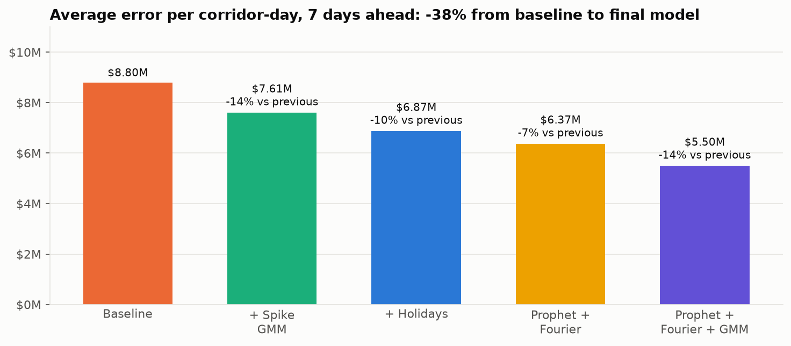
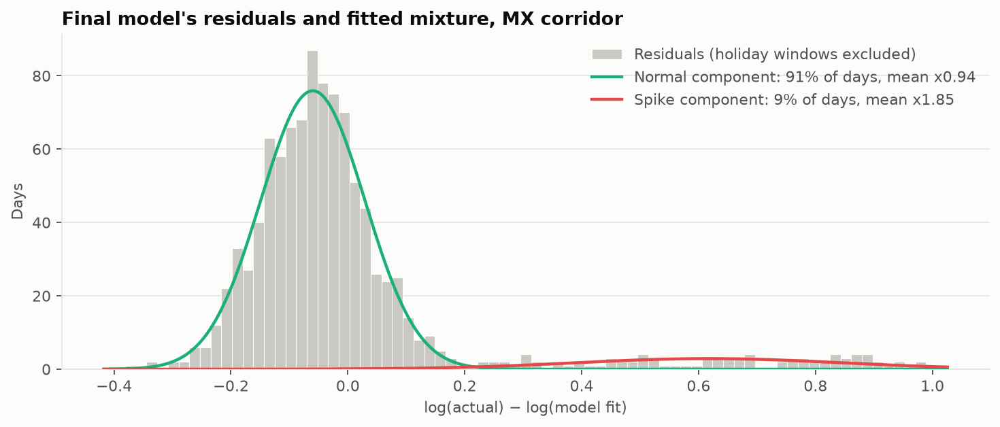
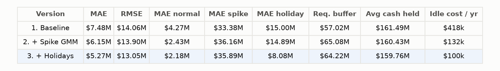
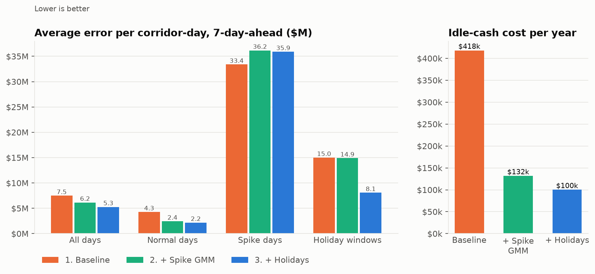
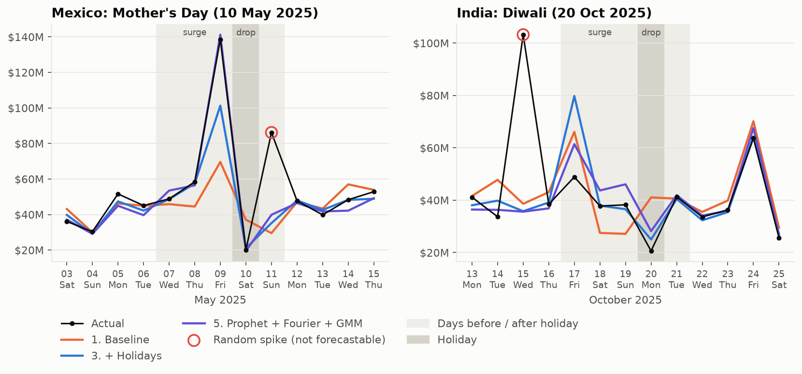
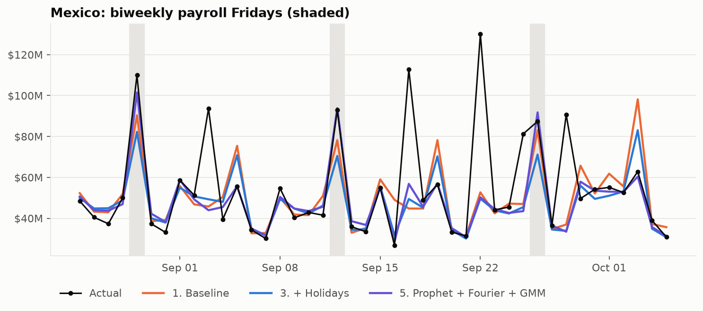

# Daily cash-flow forecaster with spike and holiday handling

A money-transfer business has to pre-fund each payout corridor every morning. Three things
break a simple seasonal forecast:

- **Random spikes** (a one-off corporate payout, a promotion) inflate the average the
  forecast is built on, so ordinary days get over-funded.
- **Scheduled spikes** (a payroll run every other Friday) are big but predictable, and a
  weekday pattern can't see them.
- **Holidays** in the receiving country cause a surge before, a drop on the day, and a
  catch-up after.

This project starts from the simple weekday-seasonal model in
[Project 1](https://github.com/marlondocouto2/weekday-seasonal-forecaster) and adds one fix
at a time. Each fix is measured the same way: **diagnose → fix → measure → dollars saved**.

## Headline result

All five versions are run on the same walk-forward backtest, and every step adds accuracy.
From the baseline to the final model, average error falls by **38%**, from $8.80M to
$5.50M per corridor-day at 7 days ahead.

The final model is Prophet with Fourier seasonalities and holiday windows, with a Gaussian
mixture cleaning out random spikes. For the same 95% protection against shortfalls, it
needs **$10.5M less cash a day** than the baseline. It also cuts the cost of over-funding
from $503k to $105k a year, at a 5% cost of capital.



## Data

All data is **simulated**: three corridors from the U.S. to Mexico, the Philippines and
India, daily from 2021-01-01 to 2025-12-31, averaging $111M a day in total
([`data.py`](src/cashflow_forecaster/data.py)). Each corridor is the product of known parts,
and every part is saved in its own column so tests can check recovery:

| Part | What is simulated |
|---|---|
| **Trend** | $25M / $12M / $15M a day at the start, growing 10–18% a year |
| **Weekday, paydays, annual** | the same as Project 1: Fri ×1.25, Sun ×0.70; lifts on the 1st, 15th and last business day; a December peak |
| **Random spikes** | about 3 a month per corridor, at random; size 1.5–3× a normal day |
| **Scheduled spikes** | a biweekly payroll run, ×1.6 every other Friday |
| **Holidays** | the receiving country's calendar from the [`holidays`](https://pypi.org/project/holidays/) package, plus Mexico's Mother's Day (10 May), added by hand |
| **Noise** | about 6% log-normal |

The true holiday effects depend on the holiday's tier:

| Tier | 3 days before | 2 days before | 1 day before | Holiday | Day after |
|---|---|---|---|---|---|
| **Major** (Christmas, New Year, Mother's Day, Diwali, Holi) | ×1.25 | ×1.40 | ×1.55 | ×0.60 | ×1.20 |
| **Minor** (all other public holidays) | – | – | – | ×0.60 | ×1.15 |

## The five versions

Every version has the same `fit(df)` / `predict(horizon or dates)` interface
([`models.py`](src/cashflow_forecaster/models.py)).

| # | Version | What it adds | Libraries |
|---|---|---|---|
| 1 | **Baseline** | Project 1: 28-day level × weekday factor × day-of-month factor | pandas |
| 2 | **+ Spike GMM** | detects random spikes and re-estimates the baseline without them | scikit-learn `GaussianMixture` |
| 3 | **+ Holidays** | holiday effects learned from past occurrences of each holiday window | `holidays` |
| 4 | **Prophet + Fourier** | a different family: Prophet trend + Fourier seasonalities + holiday windows | `prophet` |
| 5 | **Prophet + Fourier + GMM** | version 4, with the Gaussian mixture cleaning random spikes from Prophet's fit | `prophet`, scikit-learn |

### Two ways to handle a spike

There are two opposite ways to deal with a spike, and they work best in combination:

- **As seasonality (versions 4–5).** Fourier terms are sine and cosine waves. With enough of
  them at the right period, they can draw any repeating shape, including a sharp peak every
  14 days.
  - **Terms used:** weekly (order 3), biweekly with a 14-day period (order 7), monthly with a
    30.44-day period (order 15) and yearly (order 20), all on log volume.
  - **Result:** scheduled spikes are *forecast*, not just tolerated.
- **As a separate regime (versions 2, 3 and 5).** Random spikes can't be forecast. What
  matters is to keep them out of the baseline.
  - **How:** a two-component Gaussian mixture is fitted on the model's log residuals. Days
    in the high component are labelled spikes and removed, and the model is refitted.
  - **Spike allowance:** the mixture's weight × average spike size is the expected spike
    contribution, for sizing a buffer.
- **Why the order matters in version 5:** the mixture runs on *Prophet's* residuals, which
  already account for the payroll Fridays. So it removes only the spikes the seasonality
  can't explain. In Mexico it flags 0 of 69 payroll Fridays and every random spike.



### Holidays

- **Versions 2–3:** each window position (3 to 1 days before a major holiday, the day itself,
  the day after) gets a multiplicative effect. It is the median of actual ÷ normal-day fit
  over past occurrences, shrunk toward 1 when there are few: `1 + n/(n+1) × (median − 1)`.
- **Versions 4–5:** the same windows are passed to Prophet as holiday features, pooled by
  tier.
- **Calendar data:** holiday calendars are known in advance, so using future holiday dates
  is not leakage.

## Evaluation

**Backtest:** a walk-forward backtest over the last 12 months (calendar 2025), at 1, 7 and 30
days ahead. That gives 1,095 scored corridor-days per version and horizon. Code:
[`evaluate.py`](src/cashflow_forecaster/evaluate.py).

- **Refits:** versions 1–3 are refit at every daily origin. The Prophet versions are refit
  every 7 origins, since each fit takes about 0.25 seconds, and the latest fit is reused in
  between. Neither ever sees data after the origin.
- **Day types:** errors are broken down by the type of day being forecast:

  | Day type | Days |
  |---|---|
  | Normal | 842 |
  | Random spike | 82 |
  | Scheduled spike | 66 |
  | Holiday window | 105 |

- **Dollar metrics:** computed on the daily total across corridors, since that's what gets
  funded.
  - **Required buffer:** the 95th percentile of the daily shortfall.
  - **Cash held:** forecast + buffer, i.e. the cash set aside to cover 95% of days.
  - **Idle-cash cost:** average over-forecast × 5% a year.

**Results, 7 days ahead** (all horizons are in [`reports/results.csv`](reports/results.csv)):





### What each step fixed

| Step | Problem | Evidence |
|---|---|---|
| **2. + Spike GMM** | Random spikes inflated the baseline, which ran **13% high on ordinary days**. | Bias falls to +3%; normal-day error falls from $5.07M to $2.98M. |
| **3. + Holidays** | The baseline predicted an ordinary day before Mother's Day. | Holiday-window error falls from $15.4M to $9.5M. |
| **4. Prophet + Fourier** | A weekday factor can't tell payroll Fridays from ordinary ones, so it averages them (Friday ×1.57 against a true ×1.29). Payroll Fridays are under-forecast, ordinary Fridays over-forecast, and the lower, cleaner level of steps 2–3 makes the shortfall worse. | Scheduled-spike error falls from $15.4M to $6.2M. |
| **5. + GMM on Prophet** | Random spikes now inflated Prophet's fit instead: +8% on ordinary days. | Bias falls to +0.5%; normal-day error is $1.98M, the lowest of any version. |

One day shows it well. The day before Mother's Day 2025 was also a payroll Friday, with
$139M actual in Mexico. The 7-day-ahead forecasts were:

- **Baseline:** $70M.
- **Version 3:** $101M.
- **Version 5:** $141M.





### What no version fixes

- **Random spike days** stay at $36–39M error in every version. They're random by
  construction.
- **The required buffer is spike-driven:** on about a quarter of days at least one corridor
  has a random spike, so those spikes set the 95th-percentile shortfall. Versions that run
  biased high look better on the buffer alone, because the bias acts as a hidden cushion.
- **Cash held (forecast + buffer) is the fair comparison.** It falls from $174.7M to $164.2M
  a day.

### Real data

The same five versions were run on U.S. Treasury operating-cash withdrawals
(`--source treasury`, 12 months to November 2026). The Treasury's large days are mostly
**scheduled**: tax dates, benefit payment days, month-end transfers. As expected, the
Fourier approach is the one that helps there:

- **Steps 2–3:** they make Treasury error *worse* than the baseline (+5%), because they treat
  scheduled days as random.
- **Step 4 (Prophet + Fourier):** cuts error by 12.5% against step 3. The final model ends
  10% below the baseline.

## How to run

```bash
python3 -m venv .venv && source .venv/bin/activate
```

```bash
pip install -r requirements.txt
```

```bash
python scripts/run_pipeline.py && pytest
```

The pipeline runs all five versions in parallel across corridors in about a minute. It
prints what each version adds, writes `reports/results.csv` and every forecast in
`reports/backtest_forecasts.csv.gz`, and saves the charts in `reports/figures/`.

**Options:**

- **Some versions only:** `--versions 1,3,5`.
- **Public data:** `--source treasury` (needs internet; results go to `reports/treasury/`).

Settings are in [`config.py`](src/cashflow_forecaster/config.py). For a guided tour with charts, see
[`notebooks/walkthrough.ipynb`](notebooks/walkthrough.ipynb). GitHub shows it with its saved outputs; to
run it yourself, `pip install jupyter` first.

### Tests

- **Spike recovery:** the mixture finds at least 80% of true random spikes in every corridor
  (measured 92–100%). Fewer than 2% of ordinary days are flagged.
- **Spike recovery in the final model:** run on Prophet's residuals, the mixture still finds
  at least 80% of random spikes. It flags fewer than 10% of payroll Fridays (measured 0–2%).
- **Fourier terms:** they forecast payroll Fridays within 15% of the true ×1.6, while step 3
  can't see them.
- **Holiday recovery:** every estimated holiday effect is within ±15% of the true effect.
- **No leakage:** for all versions, including Prophet with weekly refits, forecasts made at
  any origin are unchanged when every later value is altered.
- **The ladder:** each step cuts error on its target days, overall MAE falls at each step,
  and version 5 beats version 3.

## What I'd do next

- **Learn the periods:** pick Fourier periods and orders by cross-validation instead of
  fixing them, or detect the spike period from the residuals' spectrum.
- **Spike-aware buffer:** size a separate spike buffer from the mixture (probability × size
  distribution), and compare holding it as cash against a credit line.
- **Treasury calendar:** add known Treasury events (tax dates, benefit payment days) as
  holiday-style regressors.
- **Next project:** use these volume forecasts as the input for FX margin
  (`fx-margin-forecaster`).
